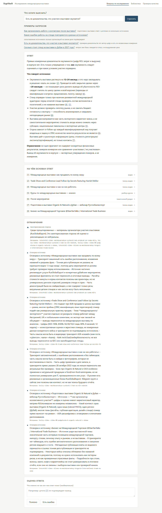
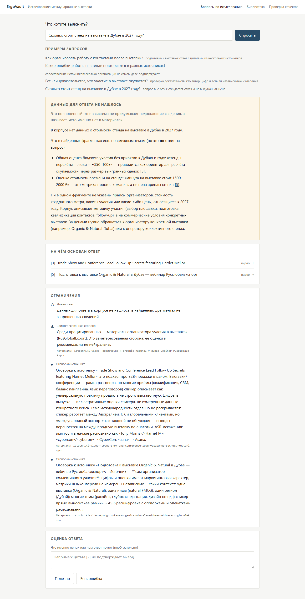

# ErgoVault RAG — база знаний по международным выставкам

**RAG-система для предпринимателя, который выходит на международные выставки.**
Вместо того чтобы перечитывать десятки разборов видео, статей и курсов, он задаёт вопрос
и получает ответ с цитатами: из какого источника, кто это сказал и насколько этому
можно верить. Если в базе ответа нет, система отказывается и не придумывает.

В основе — моё коммерческое исследование выставок: 43 заметки, около 56 тысяч слов.

### Техническая часть коротко

- **Корпус → фрагменты.** Заметки разобраны на 709 фрагментов по структуре текста:
  разделы по заголовкам, а нумерованные тезисы — каждый отдельным фрагментом, чтобы цитата
  указывала на конкретное утверждение. У каждого фрагмента есть атрибуция: источник,
  спикер, организация и пометка, если это пересказ видео, а не оригинал.
- **Эмбеддинги — `BAAI/bge-m3`, локально.** Мультиязычная модель (корпус русский, а названия
  выставок и компаний латиницей), вектор 1024 измерения, считается на CPU через
  sentence-transformers без внешних API. Векторы кэшируются на диске до записи в БД.
- **Хранение и поиск — PostgreSQL 16 + pgvector.** Две ветви поиска: полнотекстовая
  по двум tsvector (`russian` со стеммингом и `simple` для имён и брендов) и векторная
  по косинусной близости (HNSW-индекс). Ветви объединяются через Reciprocal Rank Fusion
  (`Σ 1/(60 + rank)`), вклад каждой ветви сохраняется рядом с результатом.
- **Ответ — Claude с проверкой кодом.** Модель пишет только текст. Номера ссылок,
  дословность цитат, URL и ограничения («заинтересованная сторона», «данных нет»)
  проверяются и вычисляются из БД и метаданных.
- **Оценка — свой eval-харнесс.** 33 вопроса с ручной разметкой, recall@k и MRR поиска,
  точность отказов, сравнение четырёх подходов: без поиска, полнотекстовый, гибридный RAG,
  весь корпус в контексте.

43 заметки · 709 фрагментов · bge-m3, 1024d · гибридный поиск RRF · 33 размеченных вопроса · 198 тестов.

---

## Что реализовано

| Модуль | Что делает |
| --- | --- |
| **Подготовка корпуса** | Читает заметки, извлекает метаданные и атрибуцию по словарям, режет на фрагменты, пишет воспроизводимый JSONL. Одна команда `ev prepare`. |
| **Гибридный поиск** | Полнотекстовый поиск PostgreSQL (русский и простой словари) и векторный по `bge-m3` объединяются через RRF. Фильтр видимости стоит в SQL обеих ветвей. |
| **Ответ с проверкой** | Claude пишет текст, код проверяет, что каждый номер ссылки существует и каждая цитата дословно есть во фрагменте. Не прошёл проверку — ответ не показывается. |
| **Ограничения из метаданных** | «Заинтересованная сторона», «данных нет», «пересказ видео, а не оригинал» вычисляются из полей источника, модель их не пишет. |
| **Библиотека источников** | Каталог корпуса с атрибуцией и ссылками на оригиналы. |
| **Оценка** | Прогон четырёх подходов на размеченных вопросах, метрики поиска и отказа, LLM-судья, отчёты, собранные кодом. |

Принцип — **модель не источник фактов о корпусе**. URL берутся из БД, цитаты
сверяются со строкой фрагмента, ограничения считаются из метаданных. Строгость стоит
ответов: часть ответов отклоняется из-за цитаты, не найденной дословно, и пользователь
видит это как ошибку, а не как правдоподобный текст.





### Что показало демо

Четыре сценария проверены на живом API в чистой копии проекта. Ответы модели от
запуска к запуску различаются: ниже то, что наблюдалось, а не гарантия.

| Вопрос | Что получилось | Что стоит знать |
| --- | --- | --- |
| «Как организовать работу с контактами после выставки?» | План из пяти шагов, 7 цитат | 4 из 7 цитат — мои сводные заметки; материалы RusGlobalExport отмечены как заинтересованная сторона |
| «Какие ошибки работы на стенде повторяются в разных источниках?» | Шесть ошибок, 8 цитат | Пересказ видео отслеживается (`derived_of`), зависимость сводных заметок — нет: независимых подтверждений меньше, чем выглядит |
| «Есть ли доказательства, что участие в выставке окупается?» | Измеренных доказательств нет, есть утверждения спикеров («12–24 месяца») | Утверждения видны вместе с тем, кто их сделал |
| «Сколько стоит стенд в Дубае в 2027 году?» | Отказ: цен в корпусе нет, смежные цифры помечены как «не ответ» | Ограничения к упомянутым источникам показываются и при отказе — шумно, но честно |

Корпус — результат моего коммерческого исследования выставок; RAG над ним — самостоятельное
продолжение для демонстрации.

---

## AI-assisted development

Код проекта написан ИИ-агентами. Я работал не как оператор, который принимает готовый
код, а как тех-лид параллельной команды: контракты, разметка, промпты и приёмка — мои,
реализация — исполнителей Claude Code, независимая оценка — Codex.

### Тех-лид и параллельные исполнители

| Роль | Кто | Что делает |
| --- | --- | --- |
| Тех-лид | Главная сессия Claude Code + я | Контракты, снапшот корпуса, ручная разметка, спека промптов, приёмка тикетов |
| Исполнители | Claude Code в отдельных git worktree | Один тикет — один worktree и свой пакет; параллельно и без общих файлов |
| Оценщик | Codex (GPT) | Сверяет дифф с тикетом: вторая модель смотрит на то, что написала первая |

Субагенты для этого описаны в [.claude/agents/](.claude/agents/): [`executor`](.claude/agents/executor.md)
(Sonnet) исполняет тикет, [`deep-thinker`](.claude/agents/deep-thinker.md) (Opus) разбирает
сложные сбои, [`codex-critic`](.claude/agents/codex-critic.md) запускает оценку Codex через
[scripts/codex-review.sh](scripts/codex-review.sh).

### Волны по графу зависимостей

Работа шла не списком задач, а волнами: следующая волна стартует, когда закрыто то,
от чего она зависит.

```text
Волна 0  тех-лид       ядро и модели, снапшот корпуса, проверочный набор, спека промптов
Волна 1  6 потоков     ingest · БД и миграции · эмбеддинги · eval-харнесс · фронт на моках · LLM-провайдер
Волна 2  по цепочке    поиск fts/vector/hybrid → генерация → API и журнал · LLM-судья
Волна 3  итог          эксперимент четырёх подходов · фронт на живом API · отчёт
```

Волна 0 блокировала всё остальное и не делегировалась. Проверочный набор особенно:
разметка определяет, что вообще измеряется, поэтому её нельзя отдавать тому, чью
работу ею будут мерить.

### Контракт как граница между исполнителями

Шесть параллельных worktree не договариваются между собой — они опираются на
[docs/CONTRACTS.md](docs/CONTRACTS.md): форматы JSONL, схема БД, идентификаторы, коды
ошибок API и раскладка по пакетам. Правила для исполнителя:

- **Перед тикетом читается контракт целиком.** Тикет не вправе его менять.
- **Расхождение — эскалация, а не обход.** Исполнитель ingest упёрся в несуществующий
  корневой `cli.py`, на который ссылался `pyproject.toml`. Дописать его — значит залезть
  в чужой пакет, поэтому он эскалировал. Пробел закрыл тех-лид: корневой CLI регистрирует
  подкоманды пакетов лениво, и шесть исполнителей не правят один общий файл.
- **Пустое лучше выдуманного.** Отсутствующие метаданные — `None`, атрибуция только по
  словарям; детерминизм там, где контракт его требует (URL, ограничения, атрибуция).

После параллельной фазы пакетная раскладка, нужная для изоляции исполнителей, свёрнута
в плоские модули (`ingest.py`, `db.py`, `search.py`, `answering.py`). Для такого переноса
в CLAUDE.md есть отдельное правило: проверять прежние инварианты, а не переписывать
тесты под новый результат.

### Тикеты в формате результата

Тикет в [docs/tickets/](docs/tickets/) начинается не с описания работы, а с того, что
должно лежать на диске при закрытии, и таблицы приёмки с проверяемыми числами.
Сбор этих чисел сам оказался проверкой контракта — до строчки кода нашлись два дефекта:

- `reliability_note` в корпусе встречается в двух формах, а описана была одна:
  контракт покрыл бы 2 источника из 26.
- Заголовки в тезисных заметках нумерованные («4. Основные тезисы») — поиск по
  точному заголовку не сработал бы ни на одной из 13 заметок.

Так же при ручной сверке проверочного набора с корпусом нашлись правдоподобные, но
несуществующие факты из заготовки спеки: «200 визиток без обработки» (в корпусе это
раздатка на сотрудника), «в 3,4 раза» (в корпусе «с 427 до 1463 м²»). Каждый ожидаемый
источник проверен скриптом [validate_golden.py](scripts/validate_golden.py).

### Независимая оценка другой моделью

Codex не писал код, а оценивал его: `codex exec review` получает незакоммиченный дифф
и тикет и ищет расхождения с таблицей приёмки, нарушения контракта
(`make_source_id`, схема БД, SQL вне `db.py`, фильтр видимости, цитаты из ответа модели
вместо БД, чтение holdout) и код, который ничем не проверен. Замечание без файла и строки
не принимается; P0/P1 блокируют приёмку.

### Context engineering

- **[CLAUDE.md](CLAUDE.md)** — устройство, команды и инварианты, которые нельзя менять при
  «обычном рефакторинге»: «модель не является источником фактов о корпусе», «не выдавать
  отсутствие измерений за нулевую ошибку», «проверять прежние инварианты, а не переписывать
  тесты под новый результат».
- **[AGENTS.md](AGENTS.md)** — вход для Codex и других агентов; ссылается на CLAUDE.md,
  чтобы не было двух версий правил.
- **[docs/ARCHITECTURE.md](docs/ARCHITECTURE.md)** — карта модулей, чтобы агент не искал
  код наугад.

### Хуки

Текстовое правило агент может забыть, хук — нет. [.claude/settings.json](.claude/settings.json)
закрепляет ключевые правила CLAUDE.md на уровне Claude Code:

| Хук | Событие | Что делает |
| --- | --- | --- |
| [guard.py](.claude/hooks/guard.py) | PreToolUse | Запрещает правку корпуса и ручной разметки, чтение `holdout.yml` (кроме `--include-holdout`) и `.env` |
| [ruff_on_edit.py](.claude/hooks/ruff_on_edit.py) | PostToolUse | После правки `.py` в `backend/` сразу запускает ruff и возвращает замечания агенту |
| [tests_on_stop.py](.claude/hooks/tests_on_stop.py) | Stop | Если менялся `backend/`, агент не завершит ход с красным ruff или pytest; повторно не срабатывает, чтобы не уйти в цикл |

### Инструменты

| Тип | Что | Зачем |
| --- | --- | --- |
| Git | `git worktree` | изоляция параллельных исполнителей |
| Skills | `claude-api` | сверка моделей и прайса для расчёта стоимости |
| CLI | `codex exec review` | оценка диффа против тикета другой моделью |
| CLI | `claude -p` | генерация ответов сервиса по подписке, без API-ключа |
| Тесты | Playwright | сценарии интерфейса на заготовленных ответах |

### Учёт расхода модели

Ответы идут через Claude Code CLI по подписке (`EV_LLM_BACKEND=cli`), поэтому стоимость
вызова пришлось измерять, а не брать из счёта.

- **Служебный оверхед CLI замерен.** Тривиальный запрос через `claude -p` без флагов —
  ~34–38 тыс. входных токенов: системный промпт Claude Code и определения инструментов.
  Флаги минимизации снизили это до ~16,8 тыс., ниже не опускается.
- **Три стоимости, не одна.** `raw_cost_usd` — что сообщил бэкенд, с оверхедом.
  `billed_cost_usd` — расчёт по токенам нашего промпта и ответа по прайсу
  [pricing.py](backend/ergovault/llm/pricing.py) на дату `PRICE_DATE`. Фактические
  списания по подписке — отдельная величина.
- **Находка через usage.** Рост `cache_read` до ~150 тыс. токенов показал, что модель
  делает несколько ходов за вызов: со списком запретов она получала новые инструменты
  CLI. CLI-бэкенд отключает их целиком (`--tools ""`) и передаёт промпт через stdin —
  командная строка Windows ограничена 32 767 символами.
- **Модели по ролям.** Генерация — `claude-opus-5`, судья — `claude-sonnet-5`, замеры
  и live-тесты — Haiku. Модель, версии промпта и корпуса пишутся в каждую строку прогона.

### Инженерные практики

- **Evals вместо «на глаз».** 33 вопроса с ручной разметкой в [eval/golden/](eval/golden/):
  ожидаемые источники, обязательные и запрещённые формулировки, вопросы для отказа.
  Изменения поиска измерялись прогонами «до/после» ([eval/reports/](eval/reports/)).
- **Преднастройка.** Метрики, варианты и правила чтения результата записаны в
  [eval/preregistration.md](eval/preregistration.md) до открытия holdout, чтобы не
  подбирать метрику под понравившийся итог. Holdout закрыт в коде дважды и хуком.
- **Четыре подхода на одном наборе.** Модель без поиска, полнотекстовый поиск, RAG и весь
  корпус в контексте ищут одним `search.py` и проверяются одним `answering.py` —
  отличается только то, что попадает в промпт.
- **Отчёты собирает код, а не модель.** [final-comparison.md](eval/reports/final-comparison.md)
  строится из сырых строк прогона. Сравнение не завершено: 30 из 132 вызовов не
  состоялись, судья не сверен с ручной разметкой — поэтому процентов здесь нет, а
  вывод «RAG лучше» не сделан.
- **Тесты не переписываются под результат.** Модель мокается через `LLMProvider`; тесты
  с реальным вызовом помечены `live` и в обычный прогон не входят.

### Безопасность и секреты

- **Ключ только в `.env`.** `EV_ANTHROPIC_API_KEY` нужен лишь для режима `api`, по
  умолчанию не нужен вовсе. Шаблон — [.env.example](.env.example); `.env` исключён из git
  и не попадал в историю коммитов.
- **ИИ не видит секретов.** Хук `guard.py` блокирует чтение `.env` инструментами и в
  терминале — на уровне Claude Code, а не просьбой в промпте.
- **Публикуется только публичное.** Все 43 заметки помечены `public`; исходный vault
  исследования в репозиторий не входит, закрытые материалы `corpus/pilot/` исключены
  через `.gitignore`, фильтр видимости стоит в SQL поиска, каталога и выдачи фрагментов.
- **Индексация без облака.** Эмбеддинги считаются локально; в Claude корпус попадает
  только в промпте ответа (в эксперименте `full_corpus` — целиком).

---

## Быстрый старт

Windows, PowerShell. Нужны Python 3.11+, Node.js, Docker и ~6 ГБ под модель `bge-m3`
(скачивается при первом запуске). Проверено на Python 3.12 и Node 24.

**1. Скачать проект и поставить бэкенд**

```powershell
git clone https://github.com/nikolay5nikolaevich/rag-tools.git
cd rag-tools
python -m venv .venv
.venv\Scripts\Activate.ps1
pip install -e "backend[dev,embed]"
```

**2. Поднять базу и подготовить индекс**

```powershell
docker compose up -d db   # PostgreSQL 16 + pgvector на порту 5433
ev prepare                # миграции, корпус, загрузка, векторы — около 40 минут на CPU
```

Векторы кэшируются в `corpus/v1/index/`, повторный запуск берёт их из кэша.

**3. Запустить API и интерфейс** — в двух терминалах

```powershell
uvicorn ergovault.api:app --host 127.0.0.1 --port 8000
```

```powershell
cd frontend
npm ci
npm run dev
```

Открой `http://localhost:5173`. Готовность базы: `http://127.0.0.1:8000/healthz`
возвращает `"chunks":709,"sources":43`. Первый вопрос — около минуты (грузится модель
эмбеддингов), дальше 15–30 секунд.

### Доступ к Claude

Подготовка базы и поиск работают без ключа. Для ответов — один из вариантов:

1. По умолчанию (`EV_LLM_BACKEND=cli`) — установленный [Claude Code](https://claude.com/claude-code)
   с выполненным `claude login`. Ответы идут по подписке.
2. `EV_LLM_BACKEND=api` и `EV_ANTHROPIC_API_KEY` в `.env`. Режим покрыт тестами, живым
   запуском не проверялся.

Без доступа сервис работает, а на вопрос возвращает ошибку генерации, а не пустой ответ.

### Переменные окружения

Кладутся в `.env` в корне — образец в [.env.example](.env.example).

| Переменная | Зачем |
| --- | --- |
| `EV_LLM_BACKEND` | `cli` (подписка Claude Code) или `api` (ключ). |
| `EV_ANTHROPIC_API_KEY` | Ключ для режима `api`. |
| `EV_DATABASE_URL` | Адрес PostgreSQL. |
| `EV_GEN_MODEL`, `EV_JUDGE_MODEL` | Модели ответа и судьи. |
| `EV_RETRIEVAL_MODE`, `EV_TOP_K` | Режим поиска (`hybrid` по умолчанию) и число фрагментов. |
| `EV_CORS_ORIGINS` | Адреса фронтенда через запятую. |

Если русский текст в консоли выводится кракозябрами: `$env:PYTHONIOENCODING="utf-8"`.

---

## Структура проекта

```text
backend/ergovault/  сервис: корпус, поиск, ответ, проверка цитат, HTTP API, оценка
backend/tests/      тесты бэкенда
frontend/           интерфейс: вопросы и библиотека источников
corpus/v1/          снимок заметок исследования и словари атрибуции
eval/golden/        33 вопроса с ручной разметкой
eval/reports/       отчёты прогонов и итоговое сравнение
docs/               архитектура, контракты данных, текущие тикеты
.claude/            субагенты и хуки Claude Code
CLAUDE.md, AGENTS.md  правила для ИИ-агентов
```

### Backend

| Файл | Что внутри |
| --- | --- |
| `ingest.py`, `chunking.py` | Чтение корпуса: метаданные, атрибуция по словарям, нарезка, воспроизводимый JSONL. |
| `indexing.py`, `embeddings.py` | Подготовка базы: загрузка, локальные эмбеддинги `bge-m3` с кэшем. |
| `db.py` | Весь SQL: миграции, загрузка, полнотекстовый и векторный поиск, фильтр видимости. |
| `search.py` | Поиск: текст, векторы или объединение рангов RRF. |
| `answering.py` | Ответ: промпт, вызов модели, проверка номеров и цитат, ограничения из метаданных. |
| `prompts/` | Версионированные промпты ответа (`p1`) и судьи (`j1`, `j2`). |
| `llm/` | Доступ к Claude через CLI и API, учёт токенов и стоимости. |
| `api.py` | HTTP-слой: разбор запроса, журнал запросов, коды ошибок. |
| `eval/` | Проверочный набор, метрики, четыре варианта, судья, эксперимент. |
| `cli.py` | Команды `ev`; прикладные модули его не импортируют. |
| `models.py`, `settings.py` | Модели данных и конфигурация. |

### Frontend

| Файл | Что внутри |
| --- | --- |
| `src/screens/Ask.tsx` | Вопрос, ответ, раскрытие цитат, отзыв. |
| `src/screens/Library.tsx` | Каталог источников. |
| `src/components/` | Тело ответа, список цитат, блок ограничений. |
| `src/mocks/` | Заготовленные сценарии для `npm run dev:mock` и Playwright. |

---

## Тесты

```powershell
pytest backend/tests                     # нужна запущенная база; live-тесты исключены
ruff check backend
ev eval retrieval --mode hybrid --k 5    # полнота поиска, модель не вызывается

cd frontend
npx playwright test                      # сценарии интерфейса
```

Проверка в чистой копии проекта (Windows 10, Python 3.12.10, Node 24.14, Claude Code 2.1.245):

| Шаг | Результат |
| --- | --- |
| `ev prepare` | 709/709 векторов, 39 мин на CPU |
| `ruff check backend` | без замечаний |
| `pytest backend/tests` | 198 passed, 6 deselected (live) |
| `ev eval retrieval --mode hybrid --k 5` | recall@5 = 0.58 на 19 вопросах — мало для выводов |
| `npm run build`, `npx playwright test` | 10 из 10 сценариев |
| Четыре сценария через `/api/ask` | 4 ответа, ошибок в журнале нет |
| Браузер → живой API | ответ, раскрытие цитаты, отзыв сохранён в базе |

Не «чистым» было: веса `bge-m3`, образ PostgreSQL и пакеты уже лежали в кэшах, время
скачивания не измерено. `npm run dev:mock` открывает интерфейс на заготовленных
ответах без бэкенда — только чтобы посмотреть экраны.

---

## Документация

- [docs/ARCHITECTURE.md](docs/ARCHITECTURE.md) — карта модулей, запуск, очередь задач.
- [docs/CONTRACTS.md](docs/CONTRACTS.md) — форматы данных и гарантии, включая API.
- [docs/tickets/](docs/tickets/) — действующие тикеты в формате результата.
- [eval/preregistration.md](eval/preregistration.md) — настройки эксперимента, зафиксированные заранее.
- [eval/reports/final-comparison.md](eval/reports/final-comparison.md) — сравнение четырёх подходов с разбором случаев.
- [eval/golden/README.md](eval/golden/README.md) — формат разметки вопросов.

Известный дефект: `GET /api/eval/summary` отдаёт `n_questions` = 33 для каждого
варианта, хотя доли посчитаны по 10–14 вопросам. Точные знаменатели — в отчёте.

---

## Стек

Python 3.11+ с FastAPI — сервис, PostgreSQL 16 с pgvector — хранение и поиск,
`BAAI/bge-m3` через sentence-transformers — локальные эмбеддинги,
Claude (через Claude Code CLI или API) — генерация и судья.
React с Vite и TypeScript — интерфейс, Playwright — проверка экранов.
